# Validation de la base native française

## Contrôles réalisés les 19 et 20 octobre 2026

- ROM USA CPUE Rev 1 et France CPUF contrôlées par SHA-1 ; paquets Linux et Windows v0.1.12 contrôlés par SHA-256.
- Installation réelle sous Linux : 340 fichiers nommés, trois archives de textes françaises et 29 correspondances d’archives graphiques vérifiées.
- Les fichiers installés sont recensés avec leur SHA-256 dans `universe-install.json` (local uniquement).
- Sur les 724 banques de `pl_msg.narc`, seule la banque 389 est modifiée ; seul son message 0 change. Les autres messages chiffrés restent identiques. L’original français est conservé.
- Installation Windows également générée : les 340 empreintes de ressources correspondent au manifeste ; `main.exe` est un PE x86-64. Cela ne constitue pas un test d’exécution Windows.
- Dix tests sans ROM : lecture NitroFS, limites/cycles, structure NARC, conservation des messages et commandes inconnues, chiffrement connu, caractères français, correspondances graphiques, extraction ZIP, refus d’écraser une sauvegarde et nettoyage après téléchargement invalide.
- Exécution native sous Linux avec rendu logiciel : démarrage, écran titre « Version Platine », introduction Universe, dialogues Sorbier en français, clavier, interaction avec l’écran tactile et sélection du personnage observés le 19 octobre. AppImage testée sans FUSE.

La source des outils a été restaurée après le nettoyage de l’environnement. Les dix tests ont été relancés ; GitHub Actions est vert pour `a251b08`. Le 20 octobre, l’installation a été recréée puis comparée octet par octet aux ressources sources, à l’exception du dialogue modifié. Les captures ci-dessous ont été prises dans le véritable exécutable natif le 20 octobre.

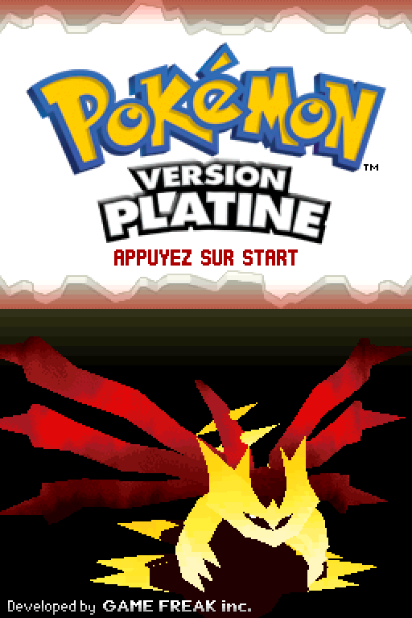

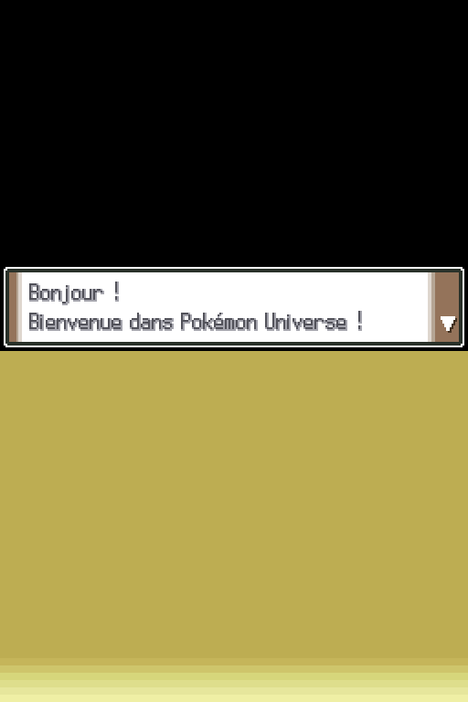

## Contrôles du 22 octobre 2026

- Nouvelle partie native : personnage TEST et rival AMI ; saisie des noms et dialogues en français.
- Arrivée dans la chambre, déplacements, rencontre du rival, passage au rez-de-chaussée, sortie à Bonaugure et entrée dans la maison du rival observés.
- Menu français **SAUVER**, confirmation, écriture de `save.bin`, arrêt complet du processus, redémarrage, écran **CONTINUER** avec TEST, puis retour dans la même chambre : reprise vérifiée. Le déplacement suivant déclenche correctement l’arrivée du rival.
- Copie de cette sauvegarde réelle par le nouvel outil, puis comparaison octet par octet : identique. Les copies restent hors Git.
- Quatorze tests Python locaux passent : les dix tests de ressources et quatre tests du lanceur (première partie sans fichier, conservation des anciens/nouveaux progrès même en cas de code de sortie non nul, échec de copie empêchant le lancement, détection d’une copie altérée).
- La CI des outils Python est désormais configurée pour Linux et Windows. Elle ne lance pas le jeu et ne remplace pas un essai graphique Windows.

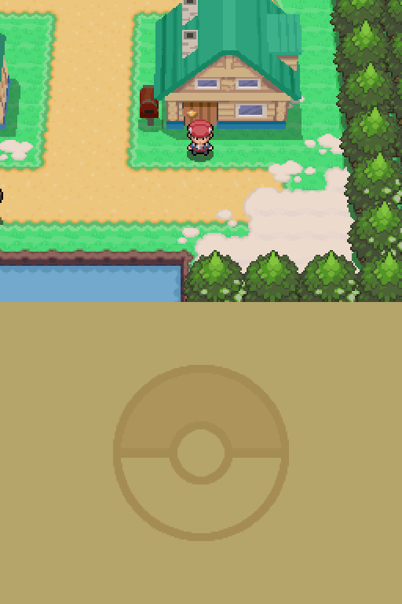

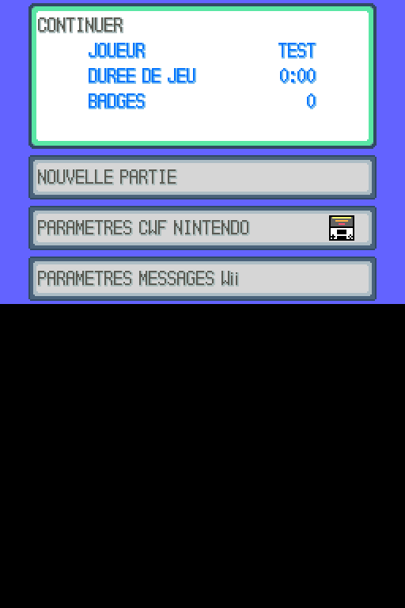

## Contrôles du 23 octobre 2026

- Comparaison octet par octet de 107 archives installées des familles `fielddata/`, `graphic/`, `battle/graphic/`, `poketool/pokegra/`, `poketool/pokeanm/`, `poketool/icongra/` et `resource/` avec les ROM personnelles validées : aucune différence par rapport aux originaux USA et aux remplacements français déclarés. Ce nombre compte des archives, pas des tuiles individuelles.
- Les 29 correspondances graphiques françaises restent celles de `content/native/graphics.fr.json`. Les cartes et modèles du monde restent ceux de Platine.
- Choix de Tortipouss et combat du rival contre Ouisticram : sprites avant/arrière, décor de combat, interface **ATTAQUE**, capacités **Charge**/**Repli**, PP et évolution de la barre de PV observés. Sélection tactile d’une capacité vérifiée. Combat terminé, retour sur la Route 201 puis scène de la mère à Bonaugure observés.
- Les 14 tests Python passent désormais sur Linux et Windows dans [GitHub Actions](https://github.com/NeptuneOff/Pokemon-Universe/actions/runs/39924992628), commit `2b0f08c`. L’échec Windows précédent venait de la comparaison textuelle des chemins courts/longs dans le test ; la comparaison porte désormais sur l’identité du fichier.

- Le nouvel outil `verify_resources.py` compare toute l’installation aux sources : **340/340 ressources conformes**, 29 correspondances graphiques françaises, aucune ressource manquante ou différente. Les 16 tests locaux passent, dont la détection d’une ressource modifiée malgré un manifeste falsifié et le maintien des sauvegardes intactes.

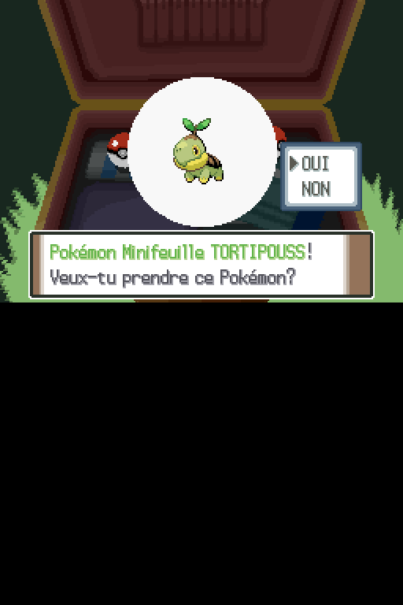

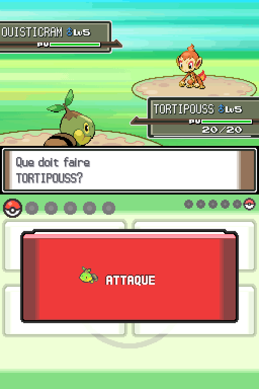

## Première enquête Universe — 26 octobre 2026

- Ajout des événements natifs de Bonaugure : choix de rôle, piste persistante, collecte d’indice et Potion unique. Les scènes obligatoires de Platine restent en place.
- Les 25 tests Python passent localement, dont les deux rôles et les deux variantes dans un lecteur de bytecode indépendant, les annulations, les erreurs rattrapables, le Sac plein et la reprise de l’état. Cette reprise simulée ne constitue pas encore une vérification de la sauvegarde native de la quête.
- Vérification sur les ROM personnelles : seul le membre 1052 de l’archive de scripts change ; dans les textes, seule la banque 554 change en plus du prologue 389. Les 15 messages originaux de Bonaugure restent identiques. Les 14 identifiants de commandes émis correspondent à la source moteur épinglée.
- Nouvelle préparation Windows générée avec l’enquête ; le moteur graphique Windows n’est pas exécuté ici. Les 12 tests du prototype web archivé passent aussi et ne valident pas la coopération native.
- Lors de cette première livraison, le parcours graphique et la reprise de l’enquête restaient à valider. Ils ont depuis été contrôlés pour le rôle analyste, ci-dessous.

## Parcours natif de l’enquête — 26 octobre 2026

- Reprise d’une sauvegarde de TEST dans sa chambre, puis scènes du rival et de la mère, sortie à Bonaugure et rencontre du chercheur : parcours exécuté dans le port Linux sans modifier la sauvegarde ni téléporter le personnage.
- Choix **Analyste** dans la fenêtre native. Le capteur indique Littorella à 6 h et le lac à 6 h 10. Une réponse erronée affiche l’explication et laisse réessayer ; **Vers le lac** donne l’indice.
- Retour au chercheur, compte rendu correspondant, réception d’une Potion. Une nouvelle visite affiche le rapport au lieu de donner une deuxième récompense. Le Sac français indique **Potion × 1**.
- Sauvegarde avec **SAUVER**, fermeture complète du processus, redémarrage puis **CONTINUER** : retour au même endroit, même rapport vers le lac, **Potion × 1** conservée après une nouvelle interaction. L’étape de quête et l’inventaire ont donc persisté dans une véritable sauvegarde native.
- Le rôle éclaireur et la direction vers Littorella restent couverts par le lecteur de bytecode indépendant ; leur parcours graphique n’a pas encore été exécuté.

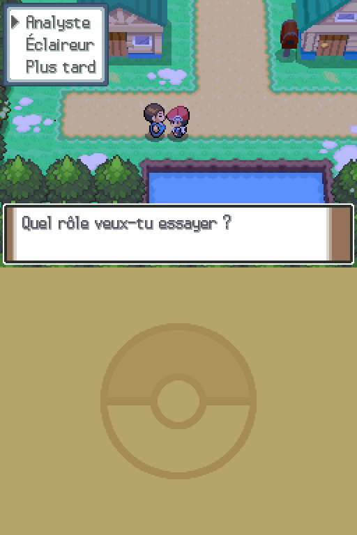

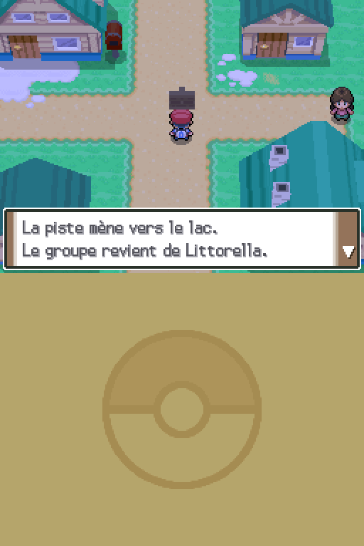

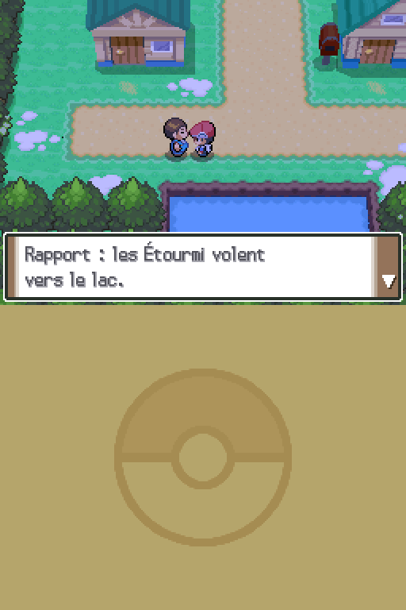

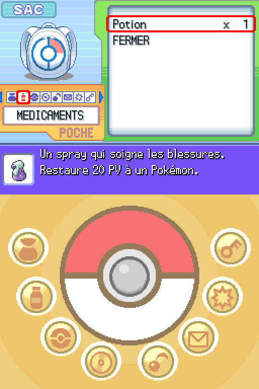

## Suite à Littorella — 26 octobre 2026

- Ajout de deux banques de scripts : laboratoire (1064) et ville (1059), avec textes ajoutés dans les banques 565 et 561. La première enquête reste inchangée. Aucune archive graphique, carte ou animation n’est modifiée.
- Après le rapport de Bonaugure, Sorbier offre **Enquête**, **Pokédex** et **Plus tard**. Les scènes d’obtention du Pokédex et les autres entrées de scripts restent identiques. Le PC pour l’analyste et l’éleveur pour l’éclaireur donnent un indice distinct ; le rapport final dépend aussi de la direction initiale.
- 32 tests Python : 31 exécutés localement, un test PowerShell réservé à Windows. Les nouveaux cas couvrent les quatre combinaisons rôle/direction, les changements de carte, la reconstitution de l’état persistant, les annulations, les mauvaises réponses, le Sac plein, les trois Poké Balls uniques, les dialogues Pokédex accessibles et le refus de ressources incompatibles.
- [GitHub Actions pour `941c916`](https://github.com/NeptuneOff/Pokemon-Universe/actions/runs/40328054165) : contrôles Linux et Windows réussis. Les 32 tests s’exécutent sous Windows, dont le lanceur PowerShell ; le jeu Windows lui-même n’est pas lancé par ces tests.
- Installations Linux et Windows préparées et comparées aux ROM personnelles : **340/340 ressources conformes** pour chacune. La sauvegarde de la première enquête est copiée octet pour octet dans une nouvelle installation ; l’ancienne reste intacte.
- Le parcours graphique de cette suite reste à valider ; les tests de scripts ne constituent pas une exécution de l’ensemble de la campagne.

## Progression de Platine après l’enquête

Dans la nouvelle installation, TEST reprend son rapport et poursuit normalement la visite du rival, la rencontre de Sorbier, le choix de Tortipouss, le combat contre Ouisticram puis la scène de la mère. Les captures suivantes viennent de cette même partie, après l’enquête et la copie de sauvegarde vers l’installation mise à jour.


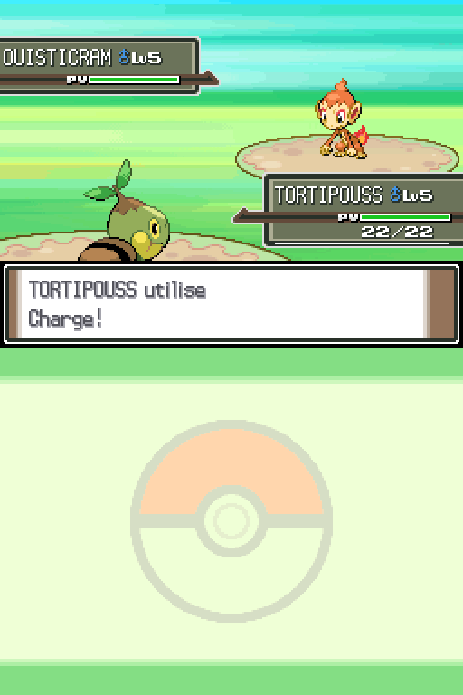

Après la scène de la mère et l’obtention des Chaussures de Sport, utilisation de **SAUVER**, arrêt du processus, redémarrage et **CONTINUER**. L’écran d’équipe retrouve **Tortipouss mâle, niveau 6, 24/24 PV**, dans la maison du joueur. Ce point de reprise est conservé séparément de l’archive destinée aux joueurs.

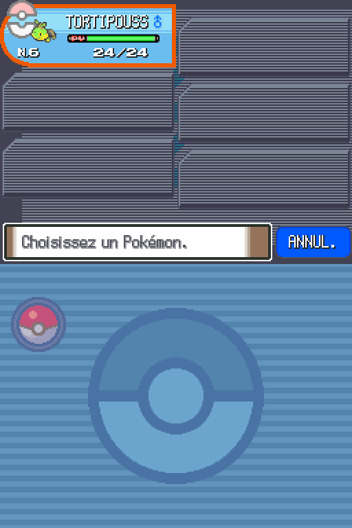

## Archive Windows prête à extraire

- Outil `package_windows.py` : copie uniquement les huit fichiers du paquet moteur vérifié, les 340 ressources recensées, la configuration et les fichiers du lanceur. Les ROM, sauvegardes de test, journaux et fichiers sans rapport sont exclus.
- `JOUER.cmd` utilise Windows PowerShell ; Python n’est pas une dépendance de cette archive. Les sauvegardes distinctes sont conservées avant et après le jeu. Deux lanceurs ne peuvent pas partager simultanément le même dossier de sauvegarde.
- Test du paquet : contenu autorisé, sauvegardes exclues, originaux inchangés, exécutable altéré refusé. Un test Windows exécute le lanceur avec un petit programme de test pour contrôler la reprise après un code de sortie non nul et le refus d’une copie de secours corrompue. Ce programme de test n’est pas le jeu.

## Distribution Git et lanceur Windows unique — 26 octobre 2026

Le parcours joueur utilise maintenant `git pull --ff-only`, puis `JOUER.bat`. Les cinq anciens lanceurs à la racine sont supprimés. Le moteur précompilé, les 340 ressources préparées et les notices sont répartis en paquets versionnés dans Git : aucun téléchargement de ZIP séparé, aucune ROM et aucun Python ne sont nécessaires pour jouer.

- Les **340/340 ressources** de la nouvelle installation Windows correspondent aux sources validées avec les trois étapes Universe (prologue, Bonaugure, Littorella). Les paquets reconstruits ont été décompressés et leurs **355/355 fichiers** comparés aux empreintes attendues.
- [CI Windows du lanceur](https://github.com/NeptuneOff/Pokemon-Universe/actions/runs/40344903368), commit `6e91155` : **42 tests réussis**, dont six nouveaux parcours d’intégration sous Windows PowerShell 5.1. Ils emploient un petit exécutable indépendant afin de vérifier l’installation, la réparation d’une ressource, la journalisation des deux sorties natives et d’un code d’erreur, l’import d’une ancienne partie, la mise à jour et le retour de version avec la progression la plus récente, le refus d’un paquet ou d’une copie de secours altérés, et le verrouillage de deux sessions concurrentes.
- Le BAT est exécuté depuis un autre dossier avec un chemin contenant espaces, accent et esperluette. Une préparation seule ne crée aucune sauvegarde et ne change pas l’installation active. Un deuxième lancement vérifie les fichiers déjà installés.
- Deux incompatibilités PowerShell 5.1 détectées pendant ces tests ont été corrigées : les empreintes utilisent directement SHA-256 .NET et l’écriture atomique transmet une vraie chaîne nulle à `File.Replace`.
- Les journaux indiquent la révision, le build, les étapes, les fichiers concernés, les exceptions et le code de sortie ; les traces natives sont conservées séparément et reprises dans le diagnostic à la fermeture. Les sauvegardes distinctes restent locales dans `native-runtime/universe-backups`.

[Contrôle de la distribution complète depuis Git](https://github.com/NeptuneOff/Pokemon-Universe/actions/runs/40346829188), commit `518eb60` : **42 tests Windows réussis**, puis `JOUER.bat -PrepareOnly` installe **355/355 fichiers** du build `e54911cd93dbf5e82db0`, avec code de sortie 0. Une seconde invocation vérifie les 355 fichiers déjà installés et termine aussi avec le code 0. Un clone Git neuf distinct a également été reconstruit et comparé aux 355 empreintes ; le dépôt ne contient qu’un seul BAT à la racine. Cette préparation valide les données et le parcours d’installation ; elle ne constitue pas une exécution graphique du jeu Windows.

## Limites de cette validation

## Composant d’extension C — 29 octobre 2026

[CI du registre natif et des règles Méga](https://github.com/NeptuneOff/Pokemon-Universe/actions/runs/40838239914), commit `c75fa69` : **47 tests réussis sous Windows**, dont la compilation/exécution du composant C avec MSVC et la reconstruction du catalogue depuis les instantanés versionnés. Les contrôles Linux et ceux du prototype archivé réussissent aussi. La préparation de la distribution Windows existante reste vérifiée par cette CI.

Le catalogue de l’instantané du 26 octobre contient 1 025 espèces nationales, 1 329 entrées avec formes et 97 formes Méga. Les tests C parcourent les formes d’origine admissibles, les deux participants du composant, le refus des mauvais objets/formes, la capacité requise pour Rayquaza et le maintien de la limite après retour à la forme d’origine. Un écart de fins de ligne Windows/Linux détecté pendant la reconstruction a été corrigé dans le générateur.

**Ce composant n’est pas encore lié au jeu distribué.** Ces contrôles ne prouvent pas l’existence de combats Méga graphiques, de captures supplémentaires, d’un nouveau Pokédex en jeu ou de coopération réseau. Le travail à raccorder au moteur est décrit dans [NATIVE-EXPANSION.md](NATIVE-EXPANSION.md). Aucun sprite Infinite Fusion n’est encore importé.

## Limites globales

La reprise de l’équipe après le premier combat est maintenant contrôlée. Le point de test durable actuel est dans la maison du joueur après la scène de la mère, avec Tortipouss niveau 6 ; les points précédents de l’enquête sont aussi conservés. La campagne entière et tous les écrans localisés ne sont pas testés. Aucun essai graphique Windows n’a été effectué. Le son n’a pas été validé (pilote audio factice dans l’environnement de test).

Aucune campagne coopérative, nouvelle région, espèce supplémentaire ni Méga-Évolution n’est livrée par cette étape.

## Reproduire les tests sans ROM

```bash
python -m unittest discover -s tests/native -v
```

## Vérification manuelle à poursuivre

Depuis le point conservé après le combat, rejoindre Littorella, obtenir le Pokédex et exécuter la suite de l’enquête. Valider aussi le parcours éclaireur, le Pokédex, puis le lancement et les boutons français sur Windows. Conserver les captures réelles et résultats dans Git à chaque étape.
